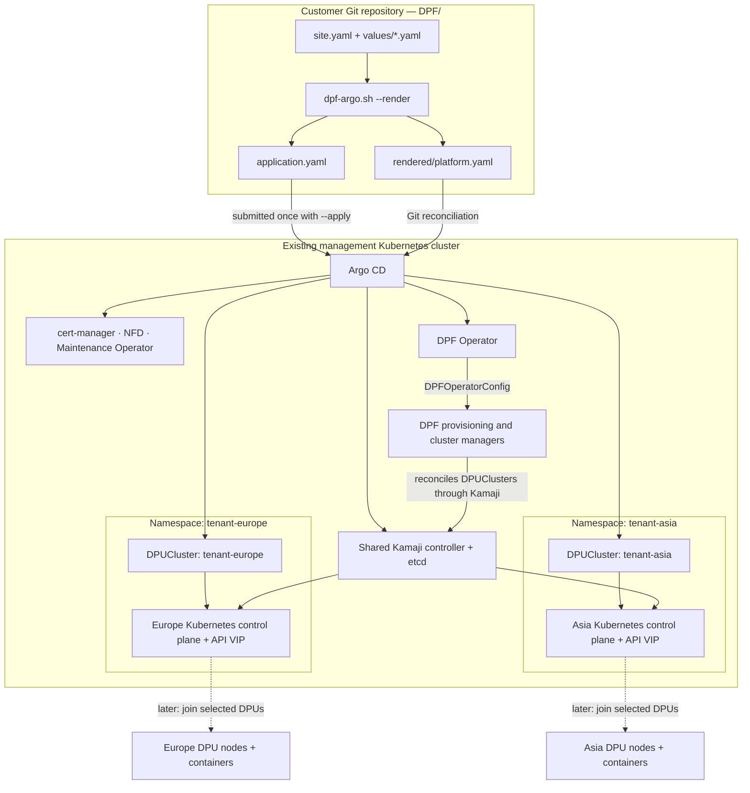

# DPF with Argo CD — customer deployment kit

Deploy the **DPF 26.4.0 management platform** to an existing, connected Kubernetes
cluster. Edit one settings file. Helm renders the bundled charts locally; Argo CD
then applies and reconciles the resulting YAML from your Git repository.

This installs cert-manager, Node Feature Discovery, Maintenance Operator, Kamaji
and its etcd store, and the DPF Operator. Site-specific operator configuration
is optional and disabled in the committed baseline. Argo CD is
installed once with Helm or reused. Local Path Provisioner is optional when you
already have a suitable StorageClass.

The outcome is the management platform, with optional tenant control planes.
[Europe and Asia tenant configuration](tenants/README.md) uses customer-reserved
VIPs. DPU discovery, BMC credentials, BFB selection, hardware provisioning and
HBN/Argus service bundles require a separate site-specific configuration.
Nothing in this kit reboots or provisions a physical DPU. Monitoring add-ons are not installed by this minimum
platform package.

For full server lifecycle management, see [NICo with DPF](../NICo/README.md)
before choosing installation ownership.

## Choose how to build the stack

Customers can build the platform in stages. Start with the supplied baseline,
then enable the site configuration and tenant control planes that they need.
Use a customer-owned fork for changes; Argo watches the configured repository,
branch and `DPF/rendered` path.

| Stage or choice | Customer setting | What Argo installs |
| --- | --- | --- |
| Prerequisites + operator | Supplied baseline: `operator.enabled: false`, `tenants.enabled: false` | cert-manager, NFD, Maintenance Operator, Kamaji/etcd and DPF Operator. |
| Storage | `storage.installLocalPath: true`, or `false` with an existing `storage.className` | Optional local-node storage, or reuse the customer's storage. |
| Configure DPF | `operator.enabled: true`; choose `zero-trust` or `host-trusted` | DPFOperatorConfig; the operator then manages the selected DPF controllers and system services. |
| Add tenant control planes | `tenants.enabled: true`; supply one or more entries | One Namespace and Kamaji-backed DPUCluster per entry. Europe and Asia are the supplied examples. |
| Provision DPUs and deploy services | Separate site-specific DPU/BFB/service YAMLs | A later stage: physical DPU provisioning and services such as HBN. This kit does not supply those deployment YAMLs. |

The required prerequisite components are bundled together in this kit; there
are no independent skip switches for cert-manager, NFD, Maintenance Operator
or Kamaji. Choosing stages does not remove their dependencies. This kit targets
a fresh platform installation; adapting it to shared existing prerequisites
requires reviewing resource ownership first. Existing Argo CD and customer
storage are the supported reuse options.

## How DPF uses the stack



Argo CD manages the desired Kubernetes objects from Git. DPF and Kamaji reconcile
those objects into controllers and tenant control planes. The tenant APIs run on
management-cluster nodes; the DPUs later join as worker nodes. The two tenant
VIPs are Kubernetes API endpoints, not workload or HBN service addresses.
Dotted connections show the later hardware/service stage, outside this kit.
Tenant namespaces and control planes do not by themselves configure data-plane
isolation or customer access permissions.

## Which YAML controls which service?

Edit the source settings/values, run `--render`, and commit the generated output.
Argo applies `rendered/platform.yaml`; it does not directly apply `site.yaml` or
Helm values. The table separates those inputs from generated Kubernetes objects.

| YAML file or setting | Resource/service it controls | Where the effect appears |
| --- | --- | --- |
| `site.yaml` → `git.*` | Generates the platform Application's repository, revision and path. | Argo CD in the management cluster. |
| `application.yaml` (generated) | Argo Application `dpf-platform`; selects `DPF/rendered`. | Determines what Argo reconciles. |
| `values/argo-cd.yaml` → `argo-bootstrap-values.yaml` (generated) | Argo CD chart settings and annotation resource tracking. | One-time Helm bootstrap; changing this file does not upgrade an existing Argo installation. |
| `values/cert-manager.yaml` | cert-manager chart, controllers and webhook. | `cert-manager` namespace; certificates consumed by the platform. |
| `site.yaml` → `storage.*`, plus `values/local-path-provisioner.yaml` | Optional Local Path Provisioner and Kamaji etcd StorageClass selection. | `local-path-provisioner` namespace and etcd PVCs. |
| `values/kamaji.yaml` | Shared Kamaji controller, etcd and bootstrap resources. | `dpf-operator-system`; DPF creates each tenant's control plane through Kamaji. |
| `values/node-feature-discovery.yaml` | Node Feature Discovery chart. | Management-cluster node feature detection and labels. |
| `values/maintenance-operator-chart.yaml` | Maintenance Operator and its configuration. | Management-cluster maintenance coordination. |
| `charts/dpf-operator-v26.4.0.tgz` | DPF Operator manifests rendered with chart defaults; no separate operator values file in this kit. | DPF Operator deployment in `dpf-operator-system`. |
| `site.yaml` → `operator.*` | Optional DPFOperatorConfig. | DPF controller configuration, provisioning mode and management API override. It does not directly flash a DPU or switch NIC/DPU mode. |
| `site.yaml` → `tenants.items` | One Namespace and DPUCluster per tenant. | DPF/Kamaji creates the tenant Kubernetes API, keepalived VIP and runtime credential Secrets. |
| `tenants/europe.example.yaml`, `tenants/asia.example.yaml` | Illustrate the Namespace + DPUCluster shape. | Reference only; placeholders, outside Argo's watched directory. |
| `rendered/platform.yaml` (generated) | All selected prerequisite/operator/tenant resources with Argo sync waves. | The deployable desired state read by Argo CD. |

Rendering adds reviewed overrides beyond the values files: Kamaji uses two
controller replicas, the selected etcd StorageClass and no implicit default
DataStore argument; the explicit `default` DataStore and translated bootstrap
Jobs have dependency ordering. The renderer also adds annotation tracking for
Argo bootstrap. See `SOURCES.txt` for the complete GitOps adaptations. Editing a
value that the renderer overrides will not change that generated setting.

## Example: Zero Trust with Europe and Asia

Keep the Git, Kubernetes and storage settings from your reviewed `site.yaml`.
Replace its `operator` and `tenants` sections with this example, then replace
**all example addresses and the interface name** with your approved site values.
The addresses below are documentation examples, not allocated lab/customer IPs.

```yaml
operator:
  enabled: true
  mode: zero-trust
  apiServerHost: 192.0.2.10
  apiServerPort: 6443
tenants:
  enabled: true
  items:
    - name: europe
      vip: 192.0.2.200
      interface: ens192
      virtualRouterID: 126
      maxNodes: 1
    - name: asia
      vip: 192.0.2.201
      interface: ens192
      virtualRouterID: 127
      maxNodes: 1
```

This example creates two tenant control planes with capacity for one DPU each.
It does not choose or provision the DPU for either tenant. For one tenant, keep
only its entry; for more, add entries with unique names, reserved VIPs and VRRP
IDs. The interface is on the management control-plane nodes. Follow the
[tenant guide](tenants/README.md) for networking requirements, commands and
verification, then use the quick start below for the full installation.

## CLI installation: Argo CD + DPF

Run the following steps in Bash on your administration machine against a **fresh
management Kubernetes cluster**. Required tools: Git, Python 3 with venv support,
Helm and kubectl. No Argo CD CLI is required. The examples use kubectl's current
context. Kubernetes, CNI/DNS, working node time and registry access must already
exist; nodes need the control-plane labels used by NVIDIA's supplied affinities.
Cluster-admin permissions are required for CRDs and RBAC.

### 1. Get the files and Python dependency

```bash
git clone git@github.com:kirson-git/openshell-dpu.git
cd openshell-dpu/DPF
python3 -m venv .venv
source .venv/bin/activate
python3 -m pip install PyYAML==6.0.1
./dpf-argo.sh --help
```

If already cloned, enter your checkout's `DPF/` directory instead of cloning
again. For customer-specific changes, use a customer-owned fork and clone its
URL. The checkout/upstream branch and `site.yaml` must refer to that repository.
The package was locally checked with Python 3.12, PyYAML 6.0.1 and Helm 4.2.4.

### 2. Select the cluster and configure the stack

```bash
kubectl config current-context
kubectl version
kubectl get nodes
vi site.yaml
```

Set `git.repoURL` to the SSH URL of your repository, keep `git.path: DPF/rendered`,
and select its branch in `git.revision`. Set `kubernetesVersion` to the actual
management version within DPF's supported platform matrix. Review storage.

The supplied baseline installs prerequisites and the DPF Operator. Set
`operator.enabled: true` and your management API address to configure Zero Trust
as well. Optionally fill in and enable [tenants](tenants/README.md). Credentials
belong in Kubernetes Secrets, not in this file.

### 3. Render the YAMLs and push them to Git

```bash
./dpf-argo.sh --render
git diff -- site.yaml rendered/platform.yaml application.yaml
git add site.yaml rendered/platform.yaml application.yaml \
  argo-bootstrap-values.yaml images.txt render-report.json
git diff --cached --quiet || git commit -m "Configure DPF platform"
git push
```

Run these commands on the branch selected in `git.revision`, with its upstream
configured. If you also changed `values/`, review and commit those files. Argo
reads the committed revision; local rendering alone does not deploy anything.

### 4. Install Argo CD

```bash
./dpf-argo.sh --bootstrap-argo
ARGO_NS="$(python3 tools/render.py --get argoNamespace)"
kubectl get pods -n "$ARGO_NS"
```

The helper installs the bundled Argo CD chart and waits for it to start. If an
installation already exists in `argoNamespace`, it checks the configuration
without upgrading it. See [Existing Argo CD](#existing-argo-cd).

For a fresh installation, the underlying Helm command is shown below as an
**alternative** to the helper, after step 3; do not run both installation paths.
The helper additionally verifies Argo configuration and controller readiness.

```bash
ARGO_NS="$(python3 tools/render.py --get argoNamespace)"
helm install argo-cd charts/argo-cd-9.4.1.tgz \
  --namespace "$ARGO_NS" --create-namespace \
  --values argo-bootstrap-values.yaml --wait --timeout 600s
```

### 5. Give Argo CD read access to the Git repository

For the supplied SSH URL, prepare a dedicated, unencrypted SSH deploy key whose
public key is registered on the repository with **read-only** access. The
administration machine's Git authentication is not automatically available to
Argo. Supply the private-key file outside this checkout when prompted:

```bash
ARGO_NS="$(python3 tools/render.py --get argoNamespace)"
DPF_REPO_URL="$(python3 -c 'import yaml; print(yaml.safe_load(open("site.yaml"))["git"]["repoURL"])')"
read -r -p "Path to Argo CD read-only Git private key: " DPF_GIT_KEY
kubectl create secret generic dpf-git-repository \
  --namespace "$ARGO_NS" \
  --from-literal=type=git \
  --from-literal=url="$DPF_REPO_URL" \
  --from-file=sshPrivateKey="$DPF_GIT_KEY" \
  --dry-run=client -o yaml | kubectl apply -f -
kubectl label secret dpf-git-repository -n "$ARGO_NS" \
  argocd.argoproj.io/secret-type=repository --overwrite
unset DPF_GIT_KEY
```

These commands create/update a Kubernetes repository Secret; no private-key
file is written into Git. If your Argo administrator already configured matching
repository credentials, skip this step. For HTTPS authentication, use the
appropriate repository credentials instead of the SSH-key example. For a
self-hosted Git server, configure its verified SSH host key in Argo's known-hosts
configuration. See the official [Argo repository configuration](https://argo-cd.readthedocs.io/en/stable/operator-manual/declarative-setup/#repositories).

### 6. Install DPF and its prerequisites through Argo CD

```bash
./dpf-argo.sh --apply
./dpf-argo.sh --status
```

`--apply` checks Argo configuration and existing resource ownership, then runs
`kubectl apply -f application.yaml`. Argo pulls `DPF/rendered` and installs the
prerequisites, operator, and selected configuration/tenants in dependency order.
DPF is not installed with a second Helm command: Argo owns its rendered resources.
This kit does not automatically adopt an existing Helm-managed DPF installation.

### 7. Monitor and verify

```bash
ARGO_NS="$(python3 tools/render.py --get argoNamespace)"
kubectl get application dpf-platform -n "$ARGO_NS" -w
```

Press Ctrl-C to stop watching once the Application is Synced/Healthy, then run:

```bash
./dpf-argo.sh --verify
kubectl get pods,pvc -n dpf-operator-system
kubectl get dpuclusters -A
```

Verification checks Argo status and management rollouts. When enabled, it also
waits for DPFOperatorConfig Ready with current observed generation and each
DPUCluster's Ready phase. A nonzero exit means installation is still progressing
or a check failed; use `--status` and inspect the reported conditions. DPU-side
services may require actual joined DPUs before full DPF readiness is reached.
A ready tenant control plane can initially have zero nodes. These checks do not
prove successful hardware provisioning or tenant traffic.

The helper prints its command-log path under `.runtime/` on each action. The
logs contain its Helm/kubectl commands; Argo's controller logs/resource tree
provide the reconciliation details. This GitOps workflow has local validation
only; see `VALIDATION.txt` for the live-test boundary.

## Files and settings

| Path | Purpose |
| --- | --- |
| `site.yaml` | Customer Git, Kubernetes, storage and DPF configuration inputs. |
| `tenants/` | Tenant guide and illustrative Europe/Asia YAMLs; not watched by Argo. |
| `values/` | Pinned NVIDIA prerequisite values; optional site adaptations go here. |
| `charts/` | Bundled versioned charts; no Helm repository setup is required. |
| `tools/render.py` | Generates YAML and translates reviewed hooks into Argo sync waves. |
| `rendered/platform.yaml` | Generated platform resources; this is Argo's source directory. |
| `application.yaml` | Generated Argo Application that points to your Git repository. |
| `argo-bootstrap-values.yaml` | Generated values for installing Argo CD once with Helm. |
| `images.txt` | Generated inventory of images visible in rendered platform resources. |
| `render-report.json` | Generated settings and content hash; detects stale local output. |
| `.runtime/` | Local command logs, excluded from Git and the customer archive. |

`images.txt` includes Deployments, Jobs, CronJobs and init containers from the
rendered platform. It excludes bootstrap Argo images and images later selected by
DPF controllers; it is not a complete air-gap mirror manifest.

The committed generated YAML installs the baseline without site-specific operator
configuration. It contains no lab inventory or credentials. Edit `site.yaml` or `values/`, render again, review the
YAML, then commit/push. Argo watches the configured revision. A branch follows
new commits; a commit SHA stays pinned. Do not hand-edit generated YAML.

| Setting | Contract |
| --- | --- |
| `git.repoURL` | Required real HTTPS or `ssh://` Git URL; no embedded password/token. |
| `git.revision` | Branch, tag or commit; default `main`. Must exist remotely. |
| `git.path` | Required relative path to generated YAML in Git; supplied `DPF/rendered`. No `..`. |
| `argoNamespace` | Argo installation/Application namespace; default `dpf-operator-system`. |
| `kubernetesVersion` | Actual management version, `major.minor.patch`; example `1.34.0`. Used for Helm rendering; does not install Kubernetes. |
| `storage.installLocalPath` | Boolean, default `true`; installs the bundled local-node provisioner. |
| `storage.className` | `local-path` when installing it; otherwise the name of an existing class. |
| `operator.enabled` | Required boolean; supplied `false` installs the operator without DPFOperatorConfig. Set `true` to emit the selected site configuration. |
| `operator.mode` | `zero-trust` (default) or `host-trusted`; controls operator configuration, not physical NIC/DPU mode. |
| `operator.apiServerHost` | Required for enabled Zero Trust configuration: management API IP/DNS, without scheme or port. Not a DPU tenant VIP. |
| `operator.apiServerPort` | Integer 1–65535, default `6443`; used for Zero Trust configuration. |

Local Path Provisioner stores data on individual nodes. For production storage,
set `installLocalPath: false` and supply the customer-approved StorageClass.
Kamaji's chart creates three etcd members; this kit does not certify storage,
scheduling, backup or recovery availability.

## What Argo CD does, in order

```text
Customer Git repository
        |
        v
Argo Application: dpf-platform
        |
        +-- -30 namespaces
        +-- -20 CRDs (server-side apply)
        +--   0 cert-manager and its webhook
        +--  10 storage, if requested
        +--  20 persistent Kamaji job RBAC/config
        +--  21 etcd certificate bootstrap job
        +--  30 Kamaji controller, webhook certificates and etcd
        +--  31 etcd authentication bootstrap job
        +--  32 default DataStore
        +--  40 NFD and Maintenance Operator
        +--  41 MaintenanceOperatorConfig
        +--  50 DPF Operator
        +--  60 DPFOperatorConfig, if enabled
        +--  70 Europe/Asia DPUClusters, if enabled
```

Argo advances sync waves after the preceding resources become healthy. The etcd
jobs are explicit Sync hooks and run again on synchronization; their certificate
and authentication operations are designed for repeat execution. Completed/failed
jobs remain available for diagnosis until the next sync replaces them. Runtime
certificates are created in Kubernetes, not generated into Git. Sync waves order
submission of DPF custom resources; Argo health alone does not prove their
controllers have finished. Use `--verify` for the enabled DPF/tenant checks.

Automated sync and self-heal are enabled. Automated pruning and cascade-deletion
finalizers are disabled. Removing files or deleting the Application therefore is
not an uninstall procedure. Storage cleanup, removal of cluster-wide components,
and migration of an existing deployment require an explicit reviewed procedure.
Do not use this kit to adopt or upgrade an existing Helm-based DPF deployment.

## Existing Argo CD

Set `argoNamespace` to its actual namespace. The same installation will deliver
the platform and DPF service Applications. Its administrator must configure:

- Annotation resource tracking: `application.resourceTrackingMethod: annotation`
  in the Argo CD configuration ConfigMap. This preserves the charts' release labels.
- Application watching for `dpf-operator-system` when Argo runs elsewhere, using
  `application.namespaces` in the Argo command-parameters configuration. The
  helper requires the literal namespace in the comma-separated ConfigMap value;
  wildcard-only or startup-flag-only configurations must be adapted by the Argo
  administrator before using this helper.
- Repository access and suitable project/RBAC policies. The generated platform
  Application uses project `default` and needs cluster-scoped deployment access.

The generated DPFOperatorConfig sets `spec.overrides.argoCDNamespace` accordingly.
The helper checks the required configuration; it does not reconfigure a shared
Argo installation. Follow the Argo migration guidance before changing tracking
on an existing installation.

## Underlying commands

The script logs every Helm/kubectl command it executes. Run commands below from
`DPF/`. Argo must watch `DPF/rendered`, not the whole `DPF` directory: the latter
also contains settings and Helm values that are not Kubernetes resources. For a fresh Argo install
using the default namespace, its installation command is:

```bash
helm install argo-cd charts/argo-cd-9.4.1.tgz \
  --namespace dpf-operator-system --create-namespace \
  --values argo-bootstrap-values.yaml --wait --timeout 600s
kubectl apply -f application.yaml
kubectl get application dpf-platform -n dpf-operator-system -o wide
```

`--apply` performs configuration and collision checks before the `kubectl apply`.
Manual application skips those checks. DPF components are then applied by Argo;
they do not appear as separate `helm list` releases.

Tenant settings are documented in [tenants/README.md](tenants/README.md).

Exactly one action is required. Optional `--config PATH` selects another site YAML;
it defaults to the `site.yaml` beside the script. Actions use kubectl's current
context. `--render` needs no Kubernetes access and makes no cluster writes.
`--bootstrap-argo` can create the Argo namespace and release; `--apply` creates or
updates the Application and thereby authorizes reconciliation. `--status` and
`--verify` only read cluster state. Failures return nonzero and remain in the log.
`--help` lists the interface. There is no uninstall/reset action.

For troubleshooting, use Argo's resource tree and these commands:

```bash
kubectl get application dpf-platform -n dpf-operator-system -o yaml
kubectl get pods,pvc -n dpf-operator-system
kubectl get events -n dpf-operator-system --sort-by=.lastTimestamp
kubectl logs -n dpf-operator-system job/kamaji-etcd-setup-1 --all-containers
kubectl logs -n dpf-operator-system job/kamaji-etcd-setup-2 --all-containers
kubectl logs -n dpf-operator-system deployment/dpf-operator-controller-manager --all-containers
```

Use your Argo namespace for the Application command if different. A named job may
not exist until its sync wave is reached. Local logs contain the wrapper's
commands; Argo's controller logs and resource tree describe its reconciliation.

## Sources and validation

See `SOURCES.txt` for exact chart versions, upstream provenance and GitOps
adaptations. See `VALIDATION.txt` for checks actually performed and the live-test
boundary. This package is a project-authored GitOps adaptation, not an NVIDIA
published installer or production qualification.

- [NVIDIA prerequisites](https://networking-docs.nvidia.com/dpf/26.4.0/helm-prerequisites)
- [DPF Zero Trust](https://networking-docs.nvidia.com/dpf/26.4.0/zero-trust-deployment)
- [Argo sync waves](https://argo-cd.readthedocs.io/en/stable/user-guide/sync-waves/)
- [Argo Helm hook semantics](https://argo-cd.readthedocs.io/en/stable/user-guide/helm/)
- [Argo private repositories](https://argo-cd.readthedocs.io/en/stable/user-guide/private-repositories/)
