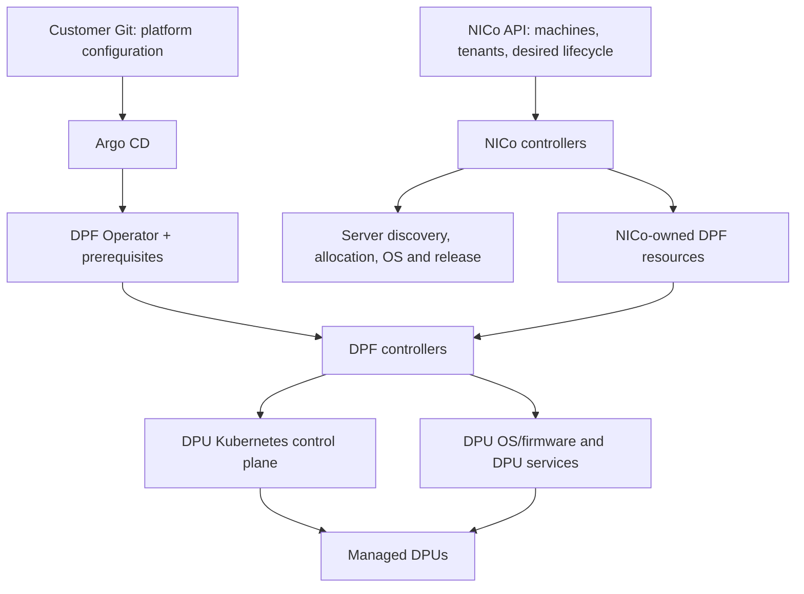

# NICo with DPF: installation choices and release comparison

**Reviewed on 2026-10-14 against NICo v2.2.1**, commit
`9a93e28c5a7e58c43910a7461d64c451335f89b6`. This directory explains how to choose
between standalone DPF and NICo using DPF. The deployable Argo package in this
repository is [DPF/](../DPF/README.md); a complete NICo Argo bootstrap package
is not included yet.

## What changes when NICo uses DPF?

DPF provisions and manages DPU software and services through Kubernetes resources.
NICo adds bare-metal infrastructure lifecycle management and uses DPF for the
DPU portion of that workflow. Installing NICo does not replace DPF.

| Responsibility | Standalone DPF | NICo using DPF |
| --- | --- | --- |
| Desired DPU configuration | Operator/customer supplies DPF resources through Git or another orchestrator. | NICo creates and reconciles the DPF resources for machines it manages. |
| DPU OS/software and service deployment | DPF provisions DPUs and deploys selected services. | DPF performs the provisioning; NICo supplies policy, desired resources and lifecycle coordination. |
| Bare-metal host lifecycle | Host discovery, allocation, host OS provisioning and tenant release require other tooling. | NICo handles discovery, validation, allocation, host provisioning, maintenance and release workflows. |
| Networking | DPF deploys networking services; the customer supplies the broader network design. | NICo adds its tenant/VPC/network policy and coordinates DPU networking services. |
| APIs and state | Kubernetes DPF APIs and related control planes. | NICo APIs and persistent infrastructure state, plus DPF's Kubernetes APIs. |
| Additional infrastructure | DPF prerequisites from this kit. | NICo also requires database, credential/PKI services and site networking; optional REST/rack services add dependencies. |
| Operations | DPF rollout and Kubernetes resource status. | NICo lifecycle/health checks and DPU service rollout coordination, plus DPF status. |

See the official [NICo overview](https://docs.nvidia.com/infra-controller/documentation/home)
and [DPF integration guide](https://docs.nvidia.com/infra-controller/documentation/getting-started/installation-options/dpf-setup).

The diagram shows the integration model; it is not a claim that this repository
already installs NICo. GitOps should own platform installation and explicit site
inputs. NICo should own the runtime DPF resources that it generates. Having both
Argo and NICo reconcile the same generated object can cause conflicting updates.

## A NICo tenant is not a DPUCluster

The Europe/Asia examples under `DPF/tenants/` create separate **Kubernetes control
planes for DPU nodes**. NICo tenants represent customer organizations and their
infrastructure allocations/networking. These are different scopes; naming a
DPUCluster `tenant-europe` does not create a NICo customer tenant or its VPC.
Do not assume a one-to-one mapping without designing the site allocation model.

## Customer installation options

| Option | Choose it when | Deployment route and boundary |
| --- | --- | --- |
| Standalone DPF | The customer already has host lifecycle tooling, or wants a DPU-focused lab. | Use [DPF CLI installation](../DPF/README.md#cli-installation-argo-cd--dpf). Optional Europe/Asia DPUClusters are included. |
| Fresh NICo + DPF site | The customer wants NICo to manage server and DPU lifecycle together. | Use the selected NICo release's `helm-prereqs/setup.sh` workflow on a fresh cluster. It installs DPF by default and bootstraps NICo dependencies. This is a Helm/script workflow, not our DPF Argo Application. |
| NICo added to an existing Argo-managed DPF platform | The customer needs GitOps ownership of the shared platform. | Requires an integration/migration plan: shared dependencies, NICo credentials/database bootstrap, DPF configuration, resource ownership and NICo image/chart versions. This repository does not yet provide an executable end-to-end installer for this option. |

Do not run the NICo full setup script over this Argo-managed DPF stack as an
add-on command. It also installs shared prerequisites. `--skip-dpf` skips the
DPF installation/enablement path; it is not a general "reuse all existing
prerequisites and integrate NICo" switch.

For the fresh NICo path, use the selected release's
[setup source](https://github.com/dsx-ai-factory/infra-controller/blob/v2.2.1/helm-prereqs/setup.sh)
and its [site configuration guide](https://github.com/dsx-ai-factory/infra-controller/blob/v2.2.1/helm-prereqs/README.md).
Customers must supply their registry/images, site identity, API/DNS addresses,
IP pools, storage, DPU API VIP/interface, and credential access before installation.
Avoid transplanting another site's credentials or address plan.

## DPF configuration differences to review

**The DPF Operator is the same software in both options.** NICo v2.2.1's
installer defaults to DPF v26.4.0, matching this kit. Adding NICo changes the
integration configuration and who creates the DPU resources; it does not require
a special NICo edition of DPF.

### What changes in the installation?

1. **Install the shared platform once.** Both paths use the DPF Operator and
   supporting Kubernetes services. Our kit renders bundled Helm charts for
   Argo CD; NICo's reference script checks out `doca-platform` and installs its
   operator source chart with Helm. The script supplies the operator image
   explicitly. This packaging difference is not a different DPF implementation.
2. **Configure DPF for NICo-managed discovery.** Keep the Zero Trust/Redfish
   provisioning model, but let NICo register DPU hardware. The table below
   identifies the exact differences from our standalone example.
3. **Provide the DPU Kubernetes control plane.** The reference NICo setup creates
   `carbide-dpf-cluster`; it must exist before NICo uses it. Our optional
   Europe/Asia examples are a different topology, not a drop-in NICo tenant map.
4. **Add NICo permissions and credentials.** NICo's controller needs Kubernetes
   RBAC for DPF resources, access to BMC credentials, and access to the selected
   service image and Helm repositories. Keep secret values outside Git.
5. **Install and configure NICo itself.** Add its Core services, database,
   credential infrastructure and site configuration. Enable its DPF integration
   and configure the provisioning software and DPU service versions. NICo and
   DPF run in the same management Kubernetes cluster in the reference design.
6. **Let NICo create its runtime DPF resources.** NICo registers DPUDevice and
   DPUNode objects and creates deployment/software/flavor/service resources.
   DPF performs the resulting DPU provisioning and service rollout. The
   installer still supplies DPFOperatorConfig and DPUCluster; NICo does not
   create those two platform objects at startup.

These steps describe the integration responsibilities, not a replacement
executable sequence. In particular, v2.2.1's
[setup.sh](https://github.com/dsx-ai-factory/infra-controller/blob/v2.2.1/helm-prereqs/setup.sh)
uses a staged first installation of NICo Core: DPF integration off, optional
BMC-root credential setup, then integration on and a controller restart.
Our Argo workflow must handle that bootstrap dependency explicitly. Copying
Helm output into Git without handling initialization is insufficient.

### Exact configuration comparison

The following compares our DPF 26.4.0 kit with the NICo v2.2.1 integration
[template](https://github.com/dsx-ai-factory/infra-controller/blob/v2.2.1/helm-prereqs/operators/dpf/dpfoperatorconfig.yaml.tmpl):

| Setting or object | Our standalone example | NICo v2.2.1 integration |
| --- | --- | --- |
| `dpuDetector.disable` | `true` in Zero Trust mode. | `true`; NICo explicitly registers managed hardware. |
| `installViaRedfish.skipDPUNodeDiscovery` | `false`. | `true`; NICo drives DPUNodes instead of automatic discovery. |
| `provisioningController.osInstallTimeout` | Not overridden by our renderer. | `90m` in the NICo template. |
| `provisioningController.dmsTimeout` | Explicitly set to `900`. | Not overridden by the NICo template. |
| `networking.highSpeedMTU` | Not overridden by our renderer. | `9000` in the template; requires a matching fabric. |
| DPUCluster placement | Optional Europe/Asia namespaces. | Reference setup creates `carbide-dpf-cluster` in `dpf-operator-system`. |
| Generated deployment resources | Customer's later DPU/service stage. | NICo creates its DPU deployment/software/flavor/service resources. |
| Management RBAC | Argo/platform access. | NICo API also needs access to its DPF resources. |

These are integration differences to implement and validate, not instructions
to patch the live lab automatically. Do not infer that copying just one field
completes NICo integration.

The timeout values above come from the executable template. The v2.2.1 manual's
example says `60m` for OS installation, while its installer template uses `90m`.
Use the template when reproducing that release's installation. Fields omitted
by one path retain DPF's behavior for that version; omission does not mean zero
or disabled. These are example settings, not universal DPF requirements.

### Target customer installer

The intended customer experience is one bootstrap command on an existing
Kubernetes cluster: install or reuse Argo CD, answer site questions, save an
editable configuration, then let Argo CD reconcile the selected platform.
The choices are standalone DPF or NICo with DPF. `DPF/` contains the deployable
DPF kit; `NICo/` contains the integration guidance for the combined option.
The combined interactive installer remains a planned deliverable as of this
v2.2.1 review, not an executable feature of this repository.

For that installer, Argo CD should own the shared platform, NICo installation
and explicit site inputs. NICo should own the runtime DPF objects it generates.
Do not commit copies of those generated objects into an Argo application that
would continually overwrite NICo's changes.

### Two Argo CD roles and prerequisite handling

The planned installer must distinguish two Argo CD roles for **both** standalone
DPF and NICo with DPF:

| Role | Responsibility | Version selection |
| --- | --- | --- |
| Platform Argo CD | Reconcile prerequisites, the DPF platform and, when selected, NICo from customer Git. | Pin the chart and application versions validated for the installer. Detect an existing installation before deciding to reuse it. |
| DPF service Argo CD | Reconcile the applications DPF creates to deploy services onto DPU clusters. | Pin the chart and application versions validated with the selected DPF release. Do not assume the platform Argo version is compatible. |

The installer must support a design with separate instances when required.
Sharing an instance is an explicit reuse choice after compatibility checks,
not an assumption. Separate instances need distinct releases and namespaces,
non-overlapping Application reconciliation scopes, and appropriate RBAC and
resource tracking. Namespaces alone do not isolate cluster-scoped Argo CRDs:
both versions must support the shared CRDs, with one defined owner for their
installation and upgrades. Reject unsupported combinations before deployment.

DPF's `spec.overrides.argoCDNamespace` must point to its service Argo instance;
the service Helm repository credentials must be available there. See NVIDIA's
[DPF integration guide](https://docs.nvidia.com/infra-controller/documentation/getting-started/installation-options/dpf-setup#12d-argo-cd-repository-secrets-for-helm-charts).
The existing DPF kit uses **one** `argoNamespace` for platform Applications and
DPF's override. Separate Argo instances are a requirement for the new installer,
not an implemented capability of that configuration field.

Prerequisite handling must be part of the installation, not a separate manual
exercise:

- Inventory existing components and validate their versions, configuration and
  ownership before reusing them. Install missing prerequisites; report conflicts
  rather than silently replacing customer-managed installations.
- For DPF, handle cert-manager, Node Feature Discovery, Maintenance Operator,
  Kamaji and its datastore, compatible storage, and the DPF service Argo role.
  Select requirements and versions from the chosen DPF release and deployment mode.
- For NICo with DPF, additionally handle the selected NICo profile's database,
  credential/PKI infrastructure, site networking dependencies and any dependencies
  of enabled REST services. Shared DPF prerequisites have one owner.
- Validate Kubernetes compatibility, API/VIP reachability, DNS, time service,
  registry access and storage before provisioning. Load-balancer installation
  is conditional on the site's VIP routing design; MetalLB is not universally
  mandatory.
- Apply dependencies in order and check readiness before dependent stages.
  Distinguish platform readiness from DPU readiness: a fresh site may have no
  enrolled DPUs yet. Record component versions, install/reuse decisions, commands
  and results, while redacting credentials. Reruns must reconcile existing state.

## Release comparison: v2.1 to v2.2

The [v2.2 release notes](https://docs.nvidia.com/infra-controller/documentation/release-notes/2026/10/2)
identify changes relevant to this lab:

- DPU service rollouts can be held until NICo confirms software readiness, with
  CLI inspection/release of maintenance holds.
- A DPF reboot-handshake fix addresses a stall affecting a second DPU on a host.
- Discovery OS gains cloud-init customization; host ingestion and database
  scaling receive improvements.
- Rack/NVLink operations, health history and REST administration expand.
- The installer adds RMS and upgrade handling; existing Flow installations with
  bundled PSM/NSM need a migration, and REST storage changes need review.

As checked on 2026-10-14, the latest non-prerelease tag is **v2.2.1**. Tags for
v2.3 release candidates also exist; they are not interchangeable with a stable
release. Use the [release policy](https://github.com/dsx-ai-factory/infra-controller/blob/main/docs/development/release_and_qa_process.md)
to select the customer support boundary.

The v2.2.1 setup script still defaults to **DPF v26.4.0**. Its DPF manual links
to v26.4.1 documentation. That discrepancy is a reason to pin and validate the
chosen combination, not to silently upgrade DPF or assume every newer chart is
compatible.

The v2.2.1 source includes opt-in generic BF4 and BF4 Astra configurations.
BF4 uses `BlueFieldSoftware` with an OS ISO and a PSID-specific PLDM bundle;
Astra additionally requires its runtime/service configuration. This is distinct
from the BF3 BFB flow. Actual hardware, firmware and service compatibility must
be checked for the selected SKU; presence of configuration code alone is not
hardware qualification. See the versioned
[DPF manual](https://github.com/dsx-ai-factory/infra-controller/blob/v2.2.1/docs/manuals/dpf.md).

## Which images need rebuilding?

A NICo release change needs release-matched artifacts. Merely changing Helm
values cannot turn old binaries into a new NICo release. Reuse already-published
verified artifacts when available; otherwise build the selected source revision.

| Artifact group | Decision for a NICo release update |
| --- | --- |
| NICo Core and enabled REST/Flow services | Obtain or build images from the selected release; update matching chart values and image digests. |
| NICo-owned DPU services | Obtain/build matching DPU agent, DHCP, FMDS and telemetry images **and their Helm charts**. Pin service versions in NICo configuration. |
| Host boot/discovery and machine-validation artifacts | Align with the selected provisioning workflow; include them for a complete reproducible server-installation lab. |
| DPF Operator and NVIDIA DOCA/HBN/DTS services | Use the selected compatible NVIDIA artifacts. A NICo update alone does not require rebuilding them. |
| cert-manager, Kamaji, Argo CD, database and other prerequisites | Follow the selected release's compatibility/upgrade plan; do not rebuild them as NICo binaries. |

The v2.2.1 Makefile has `images` for Core/REST and `images-all` for those plus
machine validation and boot artifacts. The NICo DPUService images/charts have
separate tasks under `bluefield/`; do not assume `images-all` includes that
separate service-chart publication workflow. See the pinned
[Makefile](https://github.com/dsx-ai-factory/infra-controller/blob/v2.2.1/Makefile)
and [DPUService build appendix](https://github.com/dsx-ai-factory/infra-controller/blob/v2.2.1/docs/manuals/dpf.md#appendix-building-the-nico-dpuservice-images-and-charts).

**Image-name mismatch found in v2.2.1:** the Makefile publishes Core as
`<registry>/nico:<tag>`, while `setup.sh` constructs
`<registry>/nvmetal-carbide:<tag>`. Resolve the name in the build/publication or
installer configuration before installation; a successful build alone does not
make the installer pull the right image. Preserve immutable digests and source
revision provenance when publishing the required name.

For existing NICo installations, follow the
[upgrade guide](https://docs.nvidia.com/infra-controller/documentation/operations-day-2/upgrading-nico)
for database, Vault and workload migration. Keep backup material on the local
administration machine, outside this customer repository. No rebuild, cluster
upgrade or hardware provisioning was executed as part of this comparison.
